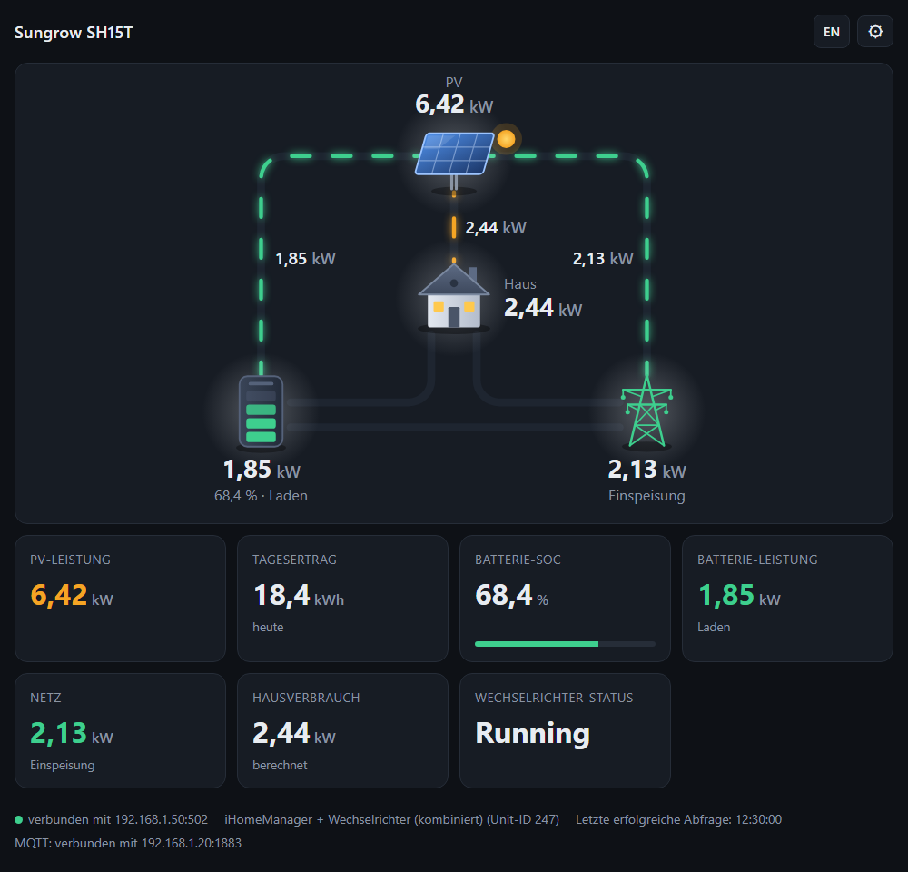
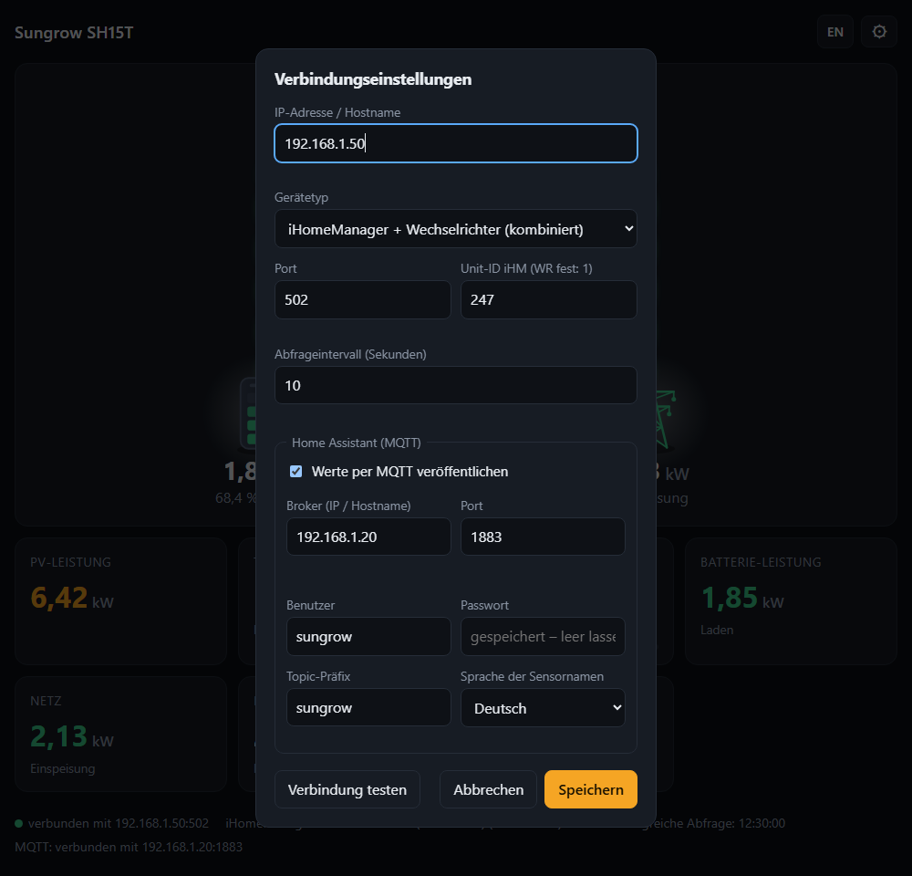

# Sungrow SH15T Dashboard

🇬🇧 [English version](README.md)

Kleiner Webserver, der die Live-Werte eines Sungrow SH15T (Hybrid-Wechselrichter
mit Batterie) per Modbus TCP ausliest, als Dashboard im Browser anzeigt und auf
Wunsch per MQTT an Home Assistant weitergibt. Der Server liest nur und schreibt
nichts auf den Wechselrichter.



*Beispielwerte. Oben der Energiefluss zwischen PV, Batterie, Haus und Netz, darunter die Einzelwerte.*

## Was du brauchst

- Einen Rechner im selben Netz wie der Wechselrichter (Ubuntu für Dauerbetrieb, Windows zum Ausprobieren)
- Python 3.10 oder neuer
- Die IP-Adresse des Wechselrichters (WiNet-S) oder des iHomeManagers; Modbus TCP muss dort erreichbar sein (Port 502)

## Installation auf Ubuntu (Dauerbetrieb)

```bash
git clone https://github.com/<your-username>/sungrow-dashboard.git
cd sungrow-dashboard
sudo bash deploy/install.sh
```

Das Skript installiert Python, kopiert das Programm nach `/opt/sungrow-dashboard`,
richtet den Dienst `sungrow-dashboard` ein und startet ihn. Am Ende zeigt es die
Adresse des Dashboards (`http://<IP-des-Rechners>:8080`). Der Dienst startet nach
jedem Neustart von selbst.

Für ein Update: `git pull`, dann das Skript erneut ausführen. Die Einstellungen bleiben erhalten.

## Start auf Windows (zum Ausprobieren)

```powershell
python -m venv .venv
.venv\Scripts\pip install -r requirements.txt
.venv\Scripts\python server.py
```

Dann `http://localhost:8080` öffnen. Der Server läuft, solange das Terminal offen ist; `Strg+C` beendet ihn.

## Einrichten

Beim ersten Aufruf öffnet sich das Einstellungsformular von selbst, später über das Zahnrad oben rechts.



1. **IP-Adresse** des Wechselrichters bzw. iHomeManagers eintragen.
2. **Gerätetyp** wählen:

   | Gerätetyp | Wann |
   |---|---|
   | WiNet-S / Wechselrichter | Der Wechselrichter hängt direkt im Netz (Unit-ID 1). |
   | iHomeManager | Nur die Werte des iHomeManagers (Unit-ID 247). Tagesertrag und Status fehlen dann. |
   | iHomeManager + Wechselrichter (kombiniert) | Der Wechselrichter hängt am iHomeManager. Liefert alle Werte und ist in diesem Fall die richtige Wahl. |

3. **Verbindung testen** drücken. Es erscheint eine Liste, welche Register Werte liefern.
4. **Speichern**. Der Server verbindet sich sofort neu, ein Neustart ist nicht nötig.

Die Einstellungen liegen in `settings.json` neben dem Programm und überstehen einen Neustart.

## Sprache

Die Oberfläche gibt es auf Deutsch und Englisch. Umgeschaltet wird mit dem Knopf `EN` bzw. `DE` oben rechts; die Wahl merkt sich der Browser. Beim ersten Aufruf richtet sich die Sprache nach dem Browser. Mit `?lang=en` oder `?lang=de` in der Adresse lässt sie sich fest vorgeben.

## Home Assistant (MQTT)

Voraussetzung in Home Assistant: ein MQTT-Broker (zum Beispiel das Add-on
„Mosquitto broker") und die MQTT-Integration.

Im Einstellungsformular unter „Home Assistant (MQTT)" den Haken setzen, Broker,
Benutzer und Passwort eintragen und speichern. In der Statuszeile unten steht
dann „MQTT: verbunden mit …", und in Home Assistant erscheint das Gerät
„Sungrow SH15T" automatisch mit elf Sensoren (PV-Leistung, Tagesertrag,
Batterie-SOC, Batterie- und Netzleistung, Hausverbrauch, Status).

Antwortet der Wechselrichter nicht, werden die Sensoren in Home Assistant
„nicht verfügbar" statt 0.

Die Namen der Sensoren gibt es auf Deutsch oder Englisch (Feld „Sprache der Sensornamen"). Die Entitäts-IDs wie `sensor.sungrow_pv_power` bleiben in beiden Fällen gleich.

## Gut zu wissen

- **Port ändern:** `python server.py --port 9000` bzw. die `ExecStart`-Zeile in `deploy/sungrow-dashboard.service` anpassen.
- **Nur im Heimnetz:** Der Server beantwortet nur Anfragen aus privaten Adressbereichen. Keine Portfreigabe im Router einrichten.
- **Ein Server pro Anlage:** Nicht zwei Instanzen gleichzeitig gegen dasselbe Gerät laufen lassen.
- **Vorzeichen:** Batterie positiv = Entladen, Netz positiv = Bezug. Die Kacheln schreiben die Richtung dazu.
- **Passwort:** Das MQTT-Passwort liegt im Klartext in `settings.json`. Die Datei gehört nicht ins Repository und steht deshalb in der `.gitignore`.
- **Dienst prüfen (Ubuntu):** `systemctl status sungrow-dashboard`, Log mit `journalctl -u sungrow-dashboard -f`.

## Mehr Details

[docs/technik.md](docs/technik.md) beschreibt die API, die Registerquellen, die
MQTT-Topics mit allen Entitätsnamen und den Test mit dem mitgelieferten Simulator.
