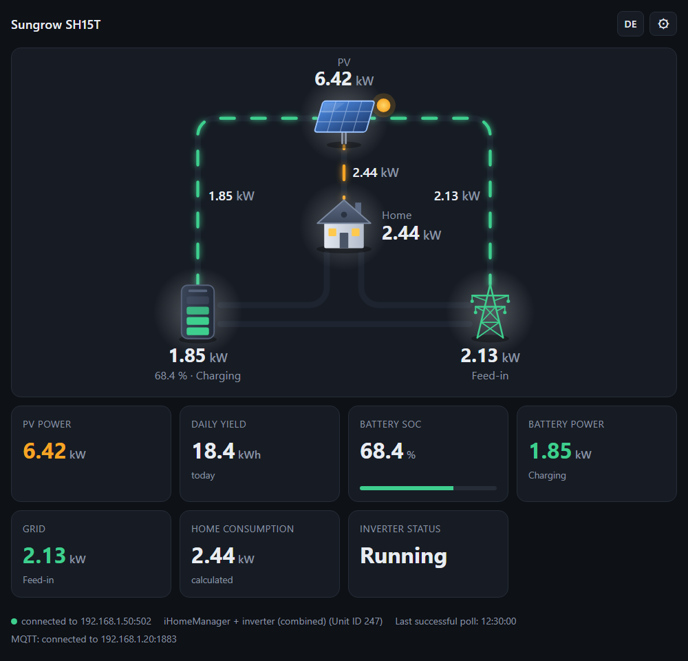
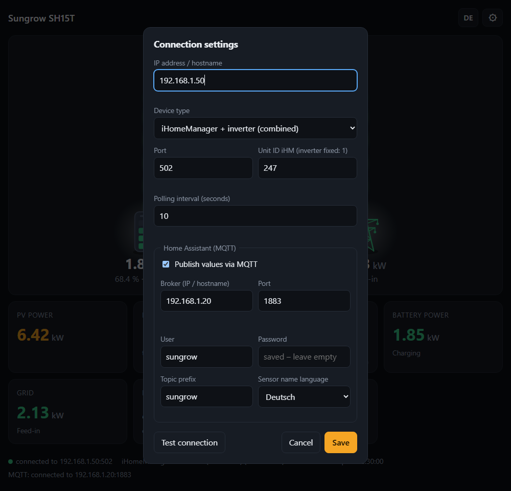

# Sungrow SH15T Dashboard

🇩🇪 [Deutsche Version](README.de.md)

A small web server that reads live values from a Sungrow SH15T (hybrid inverter
with battery) via Modbus TCP, shows them as a dashboard in the browser and can
pass them on to Home Assistant via MQTT. The server only reads; it never writes
to the inverter.



*Example values. At the top the energy flow between PV, battery, home and grid, below it the individual values.*

## What you need

- A computer on the same network as the inverter (Ubuntu for permanent operation, Windows for trying it out)
- Python 3.10 or newer
- The IP address of the inverter (WiNet-S) or of the iHomeManager; Modbus TCP must be reachable there (port 502)

## Installation on Ubuntu (permanent operation)

```bash
git clone https://github.com/<your-username>/sungrow-dashboard.git
cd sungrow-dashboard
sudo bash deploy/install.sh
```

The script installs Python, copies the program to `/opt/sungrow-dashboard`,
sets up the `sungrow-dashboard` service and starts it. At the end it prints the
address of the dashboard (`http://<IP-of-the-computer>:8080`). The service
starts by itself after every reboot.

To update: `git pull`, then run the script again. Your settings are kept.

## Running on Windows (for trying it out)

```powershell
python -m venv .venv
.venv\Scripts\pip install -r requirements.txt
.venv\Scripts\python server.py
```

Then open `http://localhost:8080`. The server runs as long as the terminal is open; `Ctrl+C` stops it.

## Setup

On the first visit the settings form opens by itself; later you reach it via the gear icon at the top right.



1. Enter the **IP address** of the inverter or iHomeManager.
2. Choose the **device type**:

   | Device type | When |
   |---|---|
   | WiNet-S / inverter | The inverter is connected to the network directly (unit ID 1). |
   | iHomeManager | Only the values of the iHomeManager (unit ID 247). Daily yield and status are missing in that case. |
   | iHomeManager + inverter (combined) | The inverter is connected to the iHomeManager. Delivers all values and is the right choice in that case. |

3. Press **Test connection**. A list shows which registers return values.
4. **Save**. The server reconnects immediately; no restart is needed.

The settings are stored in `settings.json` next to the program and survive a restart.

## Language

The interface is available in English and German. Switch with the `DE` / `EN`
button at the top right; the browser remembers the choice. On the first visit
the language follows the browser. Add `?lang=en` or `?lang=de` to the address to
force a language.

## Home Assistant (MQTT)

Required in Home Assistant: an MQTT broker (for example the "Mosquitto broker"
add-on) and the MQTT integration.

In the settings form, tick the box under "Home Assistant (MQTT)", enter broker,
user and password and save. The status line at the bottom then shows
"MQTT: connected to …", and the device "Sungrow SH15T" appears in Home
Assistant automatically with eleven sensors (PV power, daily yield, battery SOC,
battery and grid power, home consumption, status).

If the inverter does not answer, the sensors become "unavailable" in Home
Assistant instead of showing 0.

The sensor names are available in German or English (field "Sensor name
language"). The entity IDs such as `sensor.sungrow_pv_power` are the same in
both cases.

## Good to know

- **Changing the port:** `python server.py --port 9000`, or adjust the `ExecStart` line in `deploy/sungrow-dashboard.service`.
- **Home network only:** The server only answers requests from private address ranges. Do not set up port forwarding on your router.
- **One server per system:** Do not run two instances against the same device at the same time.
- **Signs:** Battery positive = discharging, grid positive = import. The tiles state the direction in words.
- **Password:** The MQTT password is stored in plain text in `settings.json`. That file does not belong in the repository and is therefore listed in `.gitignore`.
- **Checking the service (Ubuntu):** `systemctl status sungrow-dashboard`, log with `journalctl -u sungrow-dashboard -f`.
- **Log language:** The server log is in German.

## More details

[docs/technical.md](docs/technical.md) describes the API, the register sources,
the MQTT topics with all entity names and testing with the included simulator.
